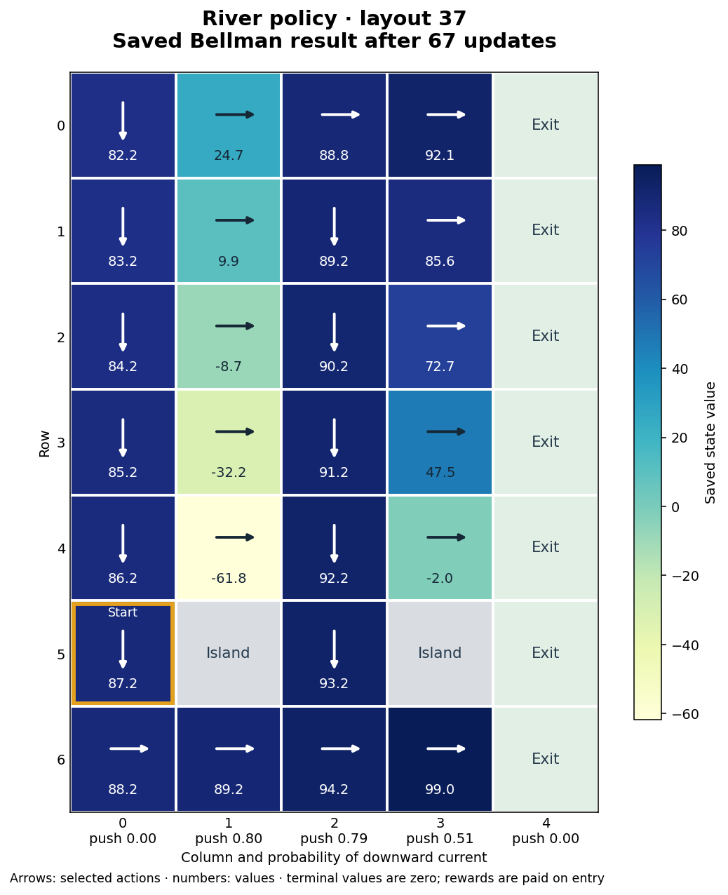

# Search and planning in small gridworlds

My Artificial Intelligence coursework compares logical inference, approximate
beliefs and planning under uncertainty. In the palace tasks, an agent must rescue
Colonel Kurtz and reach an exit while avoiding hazards. In the river task, it must
reach the opposite bank despite a random downward current.



A visualisation of the authentic saved simulation result in
`results/river_37.json`. Arrows show selected actions, numbers show state values
and the outlined cell is the start. Islands and the exit bank are terminal.
The diagram represents a generated gridworld, not observations of a real river.

## Quick start

Checked with **Python 3.12.2 on macOS** and **Python 3.12.14**,
using NumPy 2.5.4 and pip 26.2.2.
Run from this project folder:

```bash
python -m venv .venv
source .venv/bin/activate
python -m pip install --upgrade pip
python -m pip install -r requirements.txt
python -m logic_search.main --seed 42 --quiet
python -m beliefs.main --seed 42 --demo
python -m river_mdp.main --seed 5121111 --simulation-seed 2026 --episodes 20 --quiet --json runs/river_5121111.json
```

On Windows Command Prompt, activate with `.venv\Scripts\activate`.
No external dataset, account or service is required. The river command creates
`runs/` if needed and replaces only the named output file. Original results
remain in `results/`.

The logical run and the river run printed:

```text
Seed: 42; success: False; recorded actions: 3
Seed 5121111: 20/20 simulated exits; mean reward 84.95; mean steps 16.05
```

The logical heuristic fails on this layout; its count includes recorded actions
before the fatal attempt. The belief demo only displays the initial marginal
maps and candidate neighbours. It does not complete a mission. Twenty successful
river episodes do not establish guaranteed success.

## Methods

| Approach | Implementation and interpretation |
|---|---|
| Logical search | Clauses describe adjacent hazards. Rule propagation identifies some facts; BFS finds shortest routes through known safe cells. If none is available, a heuristic penalises revisits and possible hazards. It can take fatal risks and is not a complete SAT solver. |
| Marginal beliefs | Uniform maps are filtered by deterministic perceptions and renormalised. They stay uniform over compatible positions. The user chooses actions. Summed hazard scores may exceed one and are not joint danger probabilities. |
| River MDP | Synchronous Bellman updates evaluate up, down, left, right and stay, then extract a greedy policy. Rewards are +100 for an exit, −100 for an island and −1 otherwise, paid on transition. The default grid has 35 states. |

The inference rules, search, belief filtering and Bellman iteration are written
in the project. NumPy provides arrays and numerical operations. Matplotlib is
only needed to redraw the stored policy.

The river model uses `gamma=1`, tolerance 0.01 and a 1,000-update cap. Its observed
stopping condition is not a general convergence guarantee: the discounted
contraction argument does not apply. Layout and simulation seeds are separate.

## Results and visualisation

The saved runs from 17 October 2026 use simulation seed 2026, 20 episodes per
layout and at most 100 transitions per episode:

| Layout seed | Bellman iterations | Exits | Mean transitions | Mean reward |
|---|---:|---:|---:|---:|
| 5121111 | 91 | 20/20 | 16.05 | 84.95 |
| 1500 | 73 | 20/20 | 17.80 | 83.20 |
| 37 | 67 | 20/20 | 14.30 | 86.70 |
| 51211 | 27 | 20/20 | 6.40 | 94.60 |

[Saved results](results/) include values, policies and individual simulated
outcomes. Fresh runs of the quick-start layout on 23 and 26 October 2026
reproduced its saved values; the macOS run produced an identical JSON file,
including all 20 episode outcomes. New outputs were written separately.
Only layout 5121111 was rerun; the other rows remain historical results.

To redraw the main figure from the saved JSON:

```bash
python -m pip install -r requirements-visualisation.txt
python preview.py
```

Checked with Matplotlib 3.11.2. This replaces `docs/images/river-policy.png`;
it redraws existing values and does not rerun value iteration.

## Explore and test

```bash
python -m logic_search.main --seed 42 --mode manual
python -m beliefs.main --seed 42
python -m unittest discover -s tests -v
```

Use `moveU/D/L/R` to move and `grenadeU/D/L/R` to throw a grenade. `exit` works
only at the exit after the rescue. Commands ignore case; Ctrl+C stops a session.
`--show-map` reveals the hidden layout for debugging. The default palace size is
six by six. A palace needs room for its start, traps, soldier, colonel and exit:
both constructors raise `ValueError` below three by three (the beliefs palace
formerly could not finish at one by one and failed for some seeds at two by two).

All 14 tests pass with both checked Python versions. They
cover safe paths, inference, belief support, scripted rescue, transition
probabilities and boundaries, and Bellman/policy consistency. Interactive rescue
was checked with scripted test input, not a complete study of manual play.

`tests/test_palace_sizes.py` and `tests/test_river_capacity.py` add seven tests for
the palace-size check, unchanged seeded layouts and river capacity. With the 14
tests above, all 21 passed on Python 3.12.2 on macOS.

`logic_search/`, `beliefs/` and `river_mdp/` each contain their environment,
agent or solver, configuration and command-line entry point. See
[technical notes](docs/technical-notes.md) for model assumptions and previous
post-submission corrections.

## Academic context

An individual submission for *Foundations of Artificial Intelligence*, iMAT,
ICAI, Universidad Pontificia Comillas. Teaching materials are not included.
