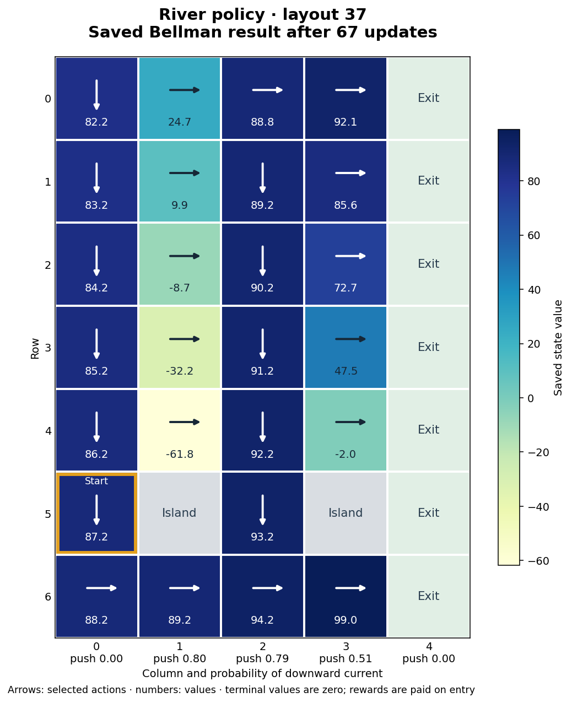

# Search and planning in small gridworlds

An individual Foundations of Artificial Intelligence project at ICAI comparing
logical search, beliefs about hidden hazards and planning under uncertainty.
A palace agent must rescue a prisoner and find the exit. A river agent must
reach the opposite bank while a random current pushes it downstream.

[Run the examples](#how-to-run) · [Methods and results](#methods-and-results) · [Repository structure](#repository-structure)

<a href="docs/images/river-policy.png"></a>

*The saved policy for river layout 37. Arrows show the chosen action, numbers
show state values and the outlined cell marks the start. Islands and the exit
bank are terminal states. This is a simulated gridworld.*

## Methods and results

| Part | Implementation | Example behaviour |
|---|---|---|
| Logical search | Clause propagation, breadth-first search through known safe cells and a fallback movement heuristic | The seed-42 agent fails after three recorded actions. The fallback can take fatal risks. |
| Beliefs | Separate hazard maps filtered by the agent's perceptions | The demo displays compatible hazard locations and candidate moves; the user chooses actions. |
| River planning | A transition model, synchronous value iteration and a greedy policy over five actions | The stored policy reaches the exit in each of 20 simulated episodes for layout 5121111. |

The project implements inference, search, belief filtering and Bellman updates.
NumPy supplies numerical arrays; Matplotlib draws the river policy.

The saved river example uses simulation seed 2026 and a limit of 100 transitions
per episode:

```text
Layout 5121111: 20/20 simulated exits
Mean transitions: 16.05
Mean reward: 84.95
```

[Results for four layouts](results/) include policies, values and individual
outcomes. These are finite simulations, not guarantees of success.

## How to run

Use Python 3.12 and run from the project folder. No external data or service is
needed.

```bash
python3.12 -m venv .venv
source .venv/bin/activate
python -m pip install --upgrade pip
python -m pip install -r requirements.txt
```

Run any of the three examples:

```bash
python -m logic_search.main --seed 42 --quiet
python -m beliefs.main --seed 42 --demo
python -m river_mdp.main --seed 5121111 --simulation-seed 2026 --episodes 20 --quiet --json runs/river_5121111.json
```

The river command creates `runs/` and replaces the named output file. It leaves
the saved examples in `results/` intact. The logical action count excludes the
fatal attempt; the belief demo displays beliefs without completing a mission.
[Technical notes](docs/technical-notes.md) explain interactive controls and how
to redraw the policy.

## Repository structure

```text
search-and-planning/
├── logic_search/                   # Palace environment, knowledge base and search agent
│   ├── knowledge_base.py           # Logical inference
│   └── main.py                     # Entry point
├── beliefs/                        # Hidden-hazard environment and belief updates
│   ├── bayesian.py                 # Hazard belief maps
│   └── main.py                     # Entry point
├── river_mdp/                      # River transitions, value iteration and simulation
│   ├── value_iteration.py          # Planning
│   └── main.py                     # Entry point
├── results/                        # Saved policies and example outcomes
├── preview.py                      # Policy visualisation
├── requirements.txt
├── requirements-visualisation.txt  # Matplotlib, for preview.py
├── docs/
│   ├── technical-notes.md          # Interactive controls and policy redrawing
│   └── images/                     # README figure
└── tests/                          # Constructed cases for inference, paths, beliefs, river
```

Start with `river_mdp/value_iteration.py` for planning, or
`logic_search/knowledge_base.py` for logical inference.

## Tests and limits

```bash
python -m unittest discover -s tests -v
```

The tests exercise model rules and constructed scenarios, including scripted
rescue sequences and transition limits. They do not exhaust every possible map.

- Clause propagation is not a complete SAT solver. The fallback search heuristic
  can enter unsafe cells.
- Hazard maps are separate marginals. Their summed scores can exceed one and
  are not joint danger probabilities; some palace objects may overlap.
- The river uses an undiscounted model (`gamma=1`), tolerance 0.01 and a
  1,000-update cap. Stopping on these examples does not prove convergence for
  every undiscounted environment.

This is coursework on small environments, rather than a general navigation
system. Teaching handouts are not included.
